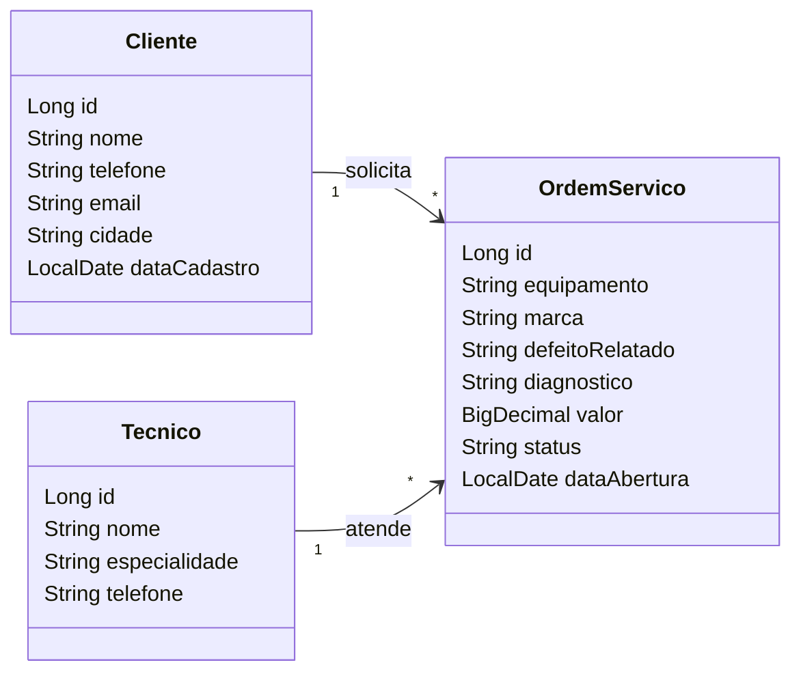

# viaOS

| | |
|---|---|
| **Aluno(a)** | Fernando Antonio Viana de Queiroz Junior |
| **Turma** | TEC-N-001788/2026 |
| **Opção escolhida** | Ordens de Serviço |
| **Versão atual** | 0.1.0 |

---

## 1. Visão geral

### 1.1 Problema

Na assistência os técnicos se perdiam em meio a pilhas de equipamentos sem saber qual consertar primeiro. Sem um fluxo claro e o controle de qual funcionário estava responsável por cada notebook ou computador, era feito anotando em uma planilha compartilhada que sempre ficava desatualizada. O sistema de ordem de serviço resolve essa desorganização interna ao centralizar o fluxo de trabalho, definir prioridades automáticas e vincular cada tarefa a um técnico responsável. Com isso, a oficina elimina o desperdício de tempo, otimiza a organização e garante que a equipe trabalhe em total sincronia, para melhor atendimento ao cliente. 

### 1.2 Canvas do projeto

| Bloco | Resposta |
|---|---|
| **Usuários** | Técnico de Informática e Gestor|
| **Problema** | Demora no preenchimento de dados em planilhas | 
| **Proposta de valor** | Agilidade no atendimento, facilidade no preenchimento das informações e na busca por informações | 
| **Funcionalidades principais** | Centralizar, organizar e automatizar informações no Banco de Dados para uma prestação de serviço ou manutenção |
| **Informações que o sistema guarda** | Dados do cliente, informações dos equipamentos, registros da execução e fechamento financeiro |
| **Indicadores** | Todas as informações sobre manutenções realizadas, quem realizou, para quem e valores finais |
| **Restrições** (prazo, tecnologia, equipe) | Projeto individual · Java 21 · Spring Boot 4 · entrega v1.0 em 11/11 |

---

## 2. Requisitos

### 2.1 Requisitos funcionais (o que o sistema FAZ)

| ID | Requisito | 
|---|---|
| RF01 | O sistema deve permitir a abertura de uma nova Ordem de Serviço, registrando dados do cliente, descrição do problema, tipo de equipamento com suas informações básicas, data/hora | 
| RF02 | O sistema deve permitir a alteração do status da OS (ex: Aberta, Em Andamento e Concluída) | 
| RF03 | O sistema deve permitir o cancelamento de uma OS mediante a inserção obrigatória de uma justificativa | 
| RF04 | O sistema deve permitir o cadastro, edição e exclusão de clientes | 

### 2.2 Requisitos não funcionais (COMO o sistema deve ser)

| ID | Requisito |
|---|---|
| RNF01 | O sistema deve exigir login e senha |
| RNF02 | O sistema deve restringir o acesso a dados financeiros e configurações apenas a administradores |
| RNF03 | O sistema deve permitir a exclusão definitiva ou o anonimato de dados pessoais de clientes quando solicitado, atendendo à Lei Geral de Proteção de Dados |

### 2.3 Regras de negócio (as REGRAS do negócio que o sistema precisa respeitar)

| ID | Regra |
|---|---|
| RN01 | Para concluir uma ordem de serviço o técnico deverá informar o diagnóstico e o valor total do serviço |
| RN02 | O técnico não poderá alterar nem excluir uma ordem de serviço concluída |

---

## 3. Histórias de usuário

**HU01 —** Como técnico de informática, quero visualizar uma lista de ordens de serviço ordenadas por prioridade e status, para que eu saiba exatamente qual aparelho devo consertar primeiro.

Critério de aceite: O sistema deve exibir uma tela de painel (dashboard) com as OS categorizadas em "Aberta", "Em Andamento" e "Concluída".

Critério de aceite: O técnico deve conseguir filtrar as ordens de serviço pelo seu próprio nome.

**HU02 —** Como técnico de informática, quero atualizar o status da ordem de serviço, para que os outros técnicos saibam que o equipamento está pronto e possa entrar em contato com o cliente.

Critério de aceite: O sistema deve disponibilizar um campo de texto obrigatório para a descrição detalhada do defeito constatado e da solução proposta.

Critério de aceite: Ao salvar, a OS deve registrar a data, o horário e o nome do técnico que realizou a atualização.

**HU03 —** Como gestor da assistência, quero visualizar o custo total das peças adquiridas para o conserto do equipamento, o valor da mão de obra do serviço, para que eu possa aprovar os orçamentos financeiramente viáveis antes de enviar ao cliente.

Critério de aceite: O sistema deve exibir em uma aba financeira da OS o detalhamento do preço de custo de cada peça utilizada versus o preço de venda cobrado do cliente.

Critério de aceite: O sistema deve calcular e exibir em destaque o lucro líquido daquela ordem de serviço.

---

## 4. Modelo de dados



---

## 5. Como executar

### No GitHub Codespaces (recomendado)
1. No repositório, clique em **Code → Codespaces → Create codespace on main** (ou abra o Codespace existente).
2. Aguarde a preparação do ambiente.
3. No terminal, execute:
   ```bash
   mvn spring-boot:run
   ```
4. Quando aparecer o aviso da porta **8080**, clique em **Abrir no navegador**.

### No computador (ferramentas instaladas)
Requisitos: JDK 21 e uma IDE (IntelliJ IDEA ou VS Code com o *Extension Pack for Java*).
Abra o projeto na IDE e execute a classe `SistemaApplication`. Acesse `http://localhost:8080`.

### Acesso
| Usuário | Senha | Perfil |
|---|---|---|
| admin | admin123 | Administrador |
| operador | operador123 | Operador |
| viana | viana020891 | Operador |

*(o login passa a ser exigido a partir do Encontro 7)*

---

## 6. Tecnologias
Java 21 · Spring Boot 4 · Spring MVC · Thymeleaf · Bootstrap 5 · Spring Data JPA · H2 (desenvolvimento) · MySQL (produção) · Spring Security · Git/GitHub

## 7. Uso de inteligência artificial
<!-- Registre aqui, de forma resumida, quando e como você usou ferramentas de IA de forma relevante no projeto. -->

## 8. Histórico de versões
| Versão | Data | Descrição |
|---|---|---|
| 0.1.0 | | Projeto inicial criado a partir do repositório modelo |

## Usuários de teste

| Usuário | Senha | Perfil | O que pode fazer |
|---|---|---|---|
| admin | admin123 | Administrador | Tudo |
| operador | operador123 | Operador | Consulta clientes e técnicos, abre ordens de serviço e muda a situação delas |